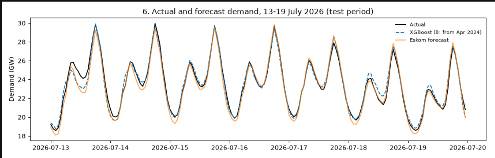
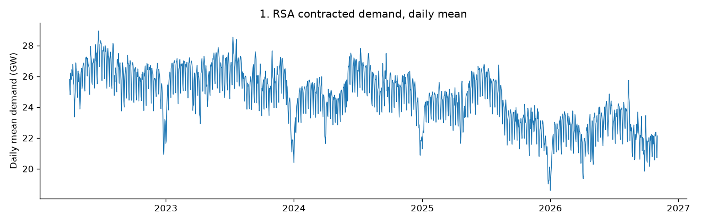

# Forecasting South Africa's Hourly Electricity Demand

Machine learning models that forecast South Africa's national electricity demand **24 hours ahead**, compared with Eskom's own published forecast.

**Author:** Ndou Fhumulani, BSc Honours in Applied Mathematics, University of Venda
**Paper:** [Short-Term Forecasting of South Africa's Hourly Electricity Demand Using Machine Learning (PDF)](paper/Ndou_Fhumulani_Electricity_Demand_Forecasting.pdf)
**Portfolio:** [ndoufhumulani.github.io](https://ndoufhumulani.github.io)

## Key results

Test period: **1 May to 2 November 2026** (4,464 hours, never used in training).

| Model | MAPE (%) | MAE (MW) | Evening peak MAE (MW) |
| --- | --- | --- | --- |
| **XGBoost (trained from Apr 2024)** | **2.30** | **522** | 462 |
| Random Forest (all data) | 2.32 | 525 | **448** |
| Eskom's published forecast | 2.40 | 545 | 535 |
| Naive (same hour yesterday) | 3.50 | 790 | 687 |
| Fourier regression (trained from Apr 2024) | 4.35 | 976 | 679 |

- The best model **matched Eskom's published forecast** overall (2.30% against 2.40% MAPE) and was **14% more accurate at the evening peak** (17:00 to 20:59).
- It reduced the error of a naive "same hour yesterday" forecast by **about a third**.
- Demand at the same hour **one week earlier** was the most important predictor.
- Full results for all nine models: [`results/results.csv`](results/results.csv).

> **Caveat:** the models are rolling 24-hour-ahead forecasts evaluated over one six-month period, so the comparison with Eskom shows comparable rather than conclusively better accuracy. See Section 6 of the paper.



## What the data shows

- **40,248 hours** of Eskom data, 1 April 2022 to 2 November 2026, with no missing or duplicate hours.
- Demand peaks on **winter evenings** (30.4 GW at 18:00 on average, against 26.9 GW in summer).
- Weekends are **6%** and public holidays **9%** below weekday demand.
- Load shedding was heavy from **April 2022 to March 2024**, then almost stopped.
- Typical daily demand fell from about **26–27 GW in 2022 to 22 GW in 2026**, consistent with the growth of rooftop solar.



## Method

1. **Cleaning** (`main.py`): parse the 12-hour timestamps, check for duplicates, gaps and impossible values, and remove the forecast-only future rows.
2. **Exploration** (`explore.py`): daily, seasonal, day-type and load shedding charts, plus the error of Eskom's own forecast.
3. **Modelling** (`model.py`):
   - **Features:** calendar and public holiday flags, a load shedding flag, Fourier terms for the daily, weekly and yearly cycles, season × hour interactions, and demand 24 hours and one week earlier.
   - **Models:** two naive baselines, Fourier regression (ordinary least squares, checked against NumPy's solver), Random Forest and XGBoost.
   - **Two training options:** all data (A), or only data from April 2024, after heavy load shedding (B).
   - **Metrics:** MAE, RMSE, MAPE and evening-peak MAE.

## How to run it

```bash
git clone https://github.com/ndoufhumulani/sa-electricity-demand-forecasting.git
cd sa-electricity-demand-forecasting
python -m pip install -r requirements.txt
```

1. Request the data from Eskom and save it in `data/` (see [`data/README.md`](data/README.md)).
2. Run the three scripts in order:

```bash
python main.py      # creates data/demand_clean.csv
python explore.py   # creates figures 01 to 05
python model.py     # creates results/results.csv and figures 06 and 07 (about 1 minute)
```

## Repository structure

```text
sa-electricity-demand-forecasting/
├── main.py          data cleaning
├── explore.py       exploratory analysis
├── model.py         features, models and evaluation
├── requirements.txt
├── data/            raw Eskom data goes here (not included)
├── figures/         charts used in the paper
├── results/         model comparison table
└── paper/           the full research paper (PDF)
```

## Data source

Eskom Holdings SOC Ltd, [Eskom Data Portal](https://www.eskom.co.za/dataportal/). The raw data is not redistributed here; request it through the portal's data request form.

## Next steps

- Strict day-ahead test using only data available 48 hours earlier
- Month-by-month comparison with Eskom's forecast
- Add lagged demand to the Fourier regression and temperature data to all models
